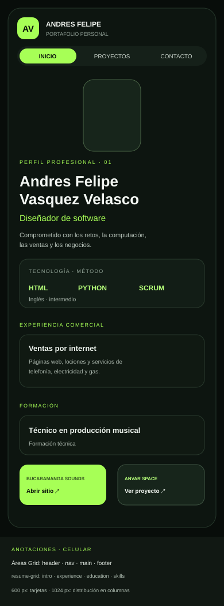
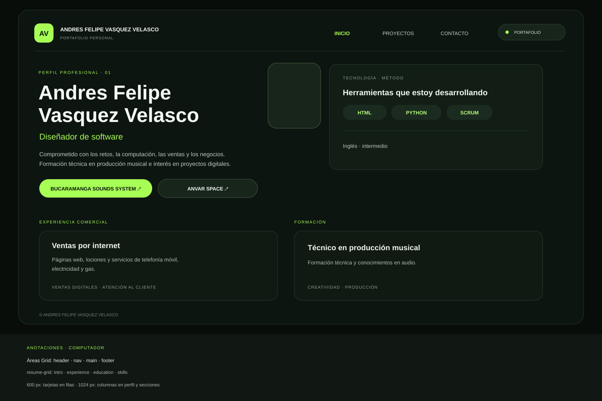
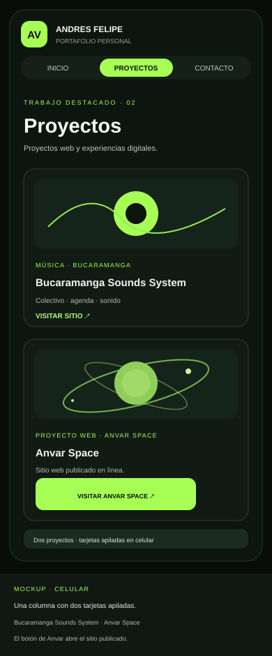
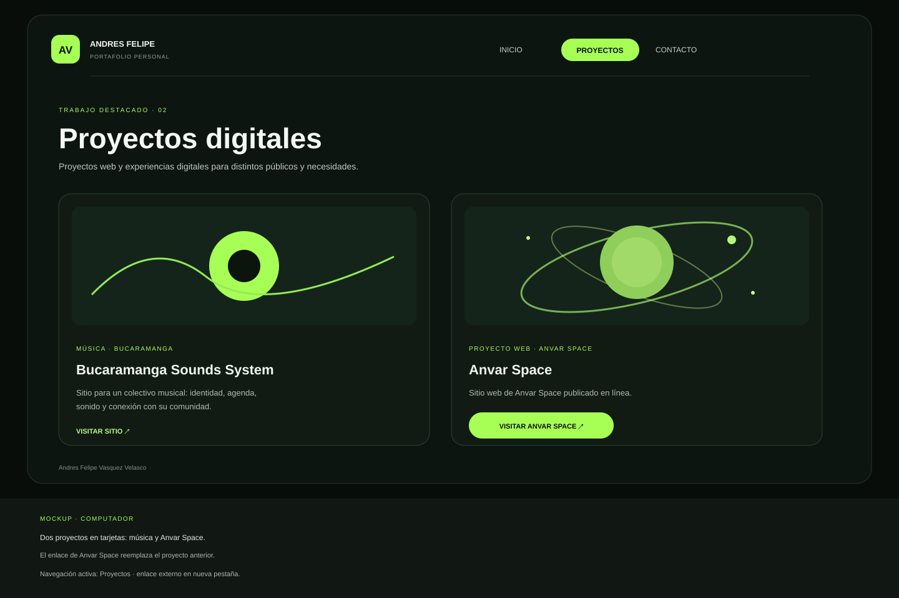
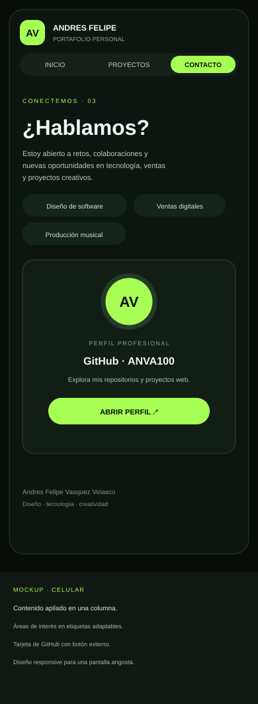
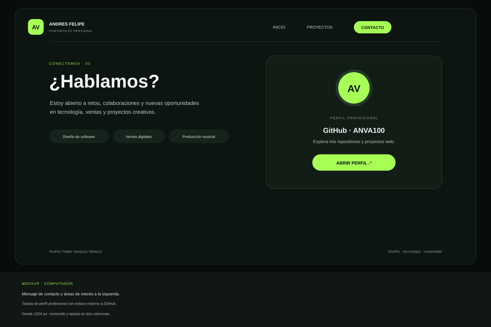

# Hoja de vida web · Andres Felipe Vasquez Velasco

Sitio personal responsive con hoja de vida, proyectos web y contacto profesional.

Los sitios destacados incluyen proyectos web realizados con HTML y CSS.

Los botones de los proyectos abren sus sitios publicados: Bucaramanga Sounds System y [Anvar Space](https://anvar-space.web.app/).

**Repositorio público:** [ANVA100/Hoja-De-Vida](https://github.com/ANVA100/Hoja-De-Vida)  
**Sitio publicado:** pendiente de activar GitHub Pages.  
**URL prevista:** <https://anva100.github.io/Hoja-De-Vida/>

## Páginas

- `index.html`: perfil, experiencia comercial, formación y habilidades.
- `proyectos.html`: sitios web de música y Anvar Space.
- `contacto.html`: enlace al perfil profesional de GitHub.

## Mockups

### Hoja de vida

### Proyectos

### Contacto

## Capturas del sitio publicado

Pendientes de tomar cuando el sitio esté en línea:

- `capturas/computador.png` — captura del sitio publicado en computador.
- `capturas/celular-real.png` — captura tomada en un teléfono real.

## Breakpoints

- **Base móvil:** una columna, contenido apilado y navegación compacta.
- **Desde 600 px:** más espacio, tarjetas amplias y pie en una fila.
- **Desde 768 px:** la foto del perfil pasa junto al texto de presentación.
- **Desde 1024 px:** cabecera y menú en una fila; perfil, formación y tarjetas en columnas.

## Publicación en GitHub Pages

El repositorio es público. Después de subir los archivos a la rama `main`:

1. Abrir **Settings → Pages** en el repositorio.
2. En **Build and deployment**, elegir **Deploy from a branch**.
3. Seleccionar la rama `main` y la carpeta `/(root)`, y guardar.
4. Esperar a que termine la publicación, abrir la URL que muestra GitHub Pages y revisar las páginas y los enlaces desde computador y celular.

La publicación todavía no está activada; actualizaré esta sección y la URL cuando el sitio esté disponible.

## Fuentes consultadas

- [GitHub Pages Quickstart](https://docs.github.com/en/pages/quickstart)
- [Configurar una fuente de publicación para GitHub Pages](https://docs.github.com/en/pages/getting-started-with-github-pages/configuring-a-publishing-source-for-your-github-pages-site)
- [Bucaramanga Sounds System](https://github.com/ANVA100/bucaramanga-sounds-system)

## Lista de verificación

- [x] **R1–R4:** viewport, enfoque Mobile First, dos breakpoints y Grid responsive.
- [x] **R5–R10:** tarjetas adaptables, ancho máximo, medios fluidos, menú común, rutas relativas y enlaces externos en otra pestaña.
- [ ] **R11:** validar las tres páginas con el validador W3C.
- [x] **R12:** repositorio público.
- [ ] **R13–R14:** activar Pages y comprobar la publicación, los enlaces y las imágenes en el sitio en línea.
- [ ] **R15:** completar el enlace al sitio publicado cuando se active Pages.
- [x] **R16:** mockups de las tres páginas en celular y computador.
- [ ] **R17:** añadir capturas del sitio publicado en dos dispositivos, una de un teléfono real.
- [x] **R18:** explicar los breakpoints.
- [ ] **R19:** completar la descripción en pasado después de publicar y verificar el sitio.
